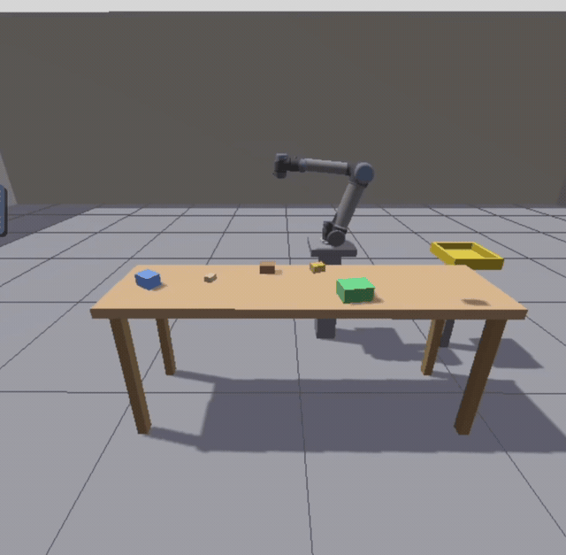

   
  UR5 on a linear rail clearing a table — stereo 3D pose estimation, YOLOv8-OBB, MoveIt 2.
  Code: <a href="https://github.com/polina-vaganova/vision-guided-grasping">vision-guided-grasping</a>

   
  <b>C++ on bare metal</b> — a maze game for the Arduboy running on an ATmega32u4:
  14.8 KB of flash, 1.8 KB of RAM, levels stored in <code>PROGMEM</code>.
  Code: <a href="https://github.com/polina-vaganova/arduboy-puzzle-maze">arduboy-puzzle-maze</a>

## About me

ML Engineer working with LLMs, computer vision and robotics.

- **Computer vision & robotics:** 3D pose estimation from stereo, camera geometry and calibration, object detection, ROS 2 manipulation
- **LLM / NLP:** evaluation, benchmarks, LLM-as-a-judge, R&D of LLM agents
- **Education:** B.Sc. in Robotics (MSTU "STANKIN"), School 21 — Machine Learning

## Projects

| Project | Description |
|---|---|
| [vision-guided-grasping](https://github.com/polina-vaganova/vision-guided-grasping) | Autonomous pick & place with a UR5 on a linear rail: stereo 3D pose estimation without a depth sensor, YOLOv8-OBB, MoveIt 2, Gazebo Harmonic. 184 scenarios / 715 grasp attempts logged and analysed |
| [arduboy-puzzle-maze](https://github.com/polina-vaganova/arduboy-puzzle-maze) | Memory-based maze game for the Arduboy — C++ on an ATmega32u4 with 2.5 KB of RAM, levels kept in `PROGMEM` |
| [task-variants-generator](https://github.com/polina-vaganova/task-variants-generator) | LLM service that generates variants of school assignments: GigaChat, FastAPI, PostgreSQL + pgvector · hackathon |
| [event-invite-generator](https://github.com/polina-vaganova/event-invite-generator) | AI-generated invitation cards for events: LLM API, Flask, PostgreSQL · hackathon |

## Stack

